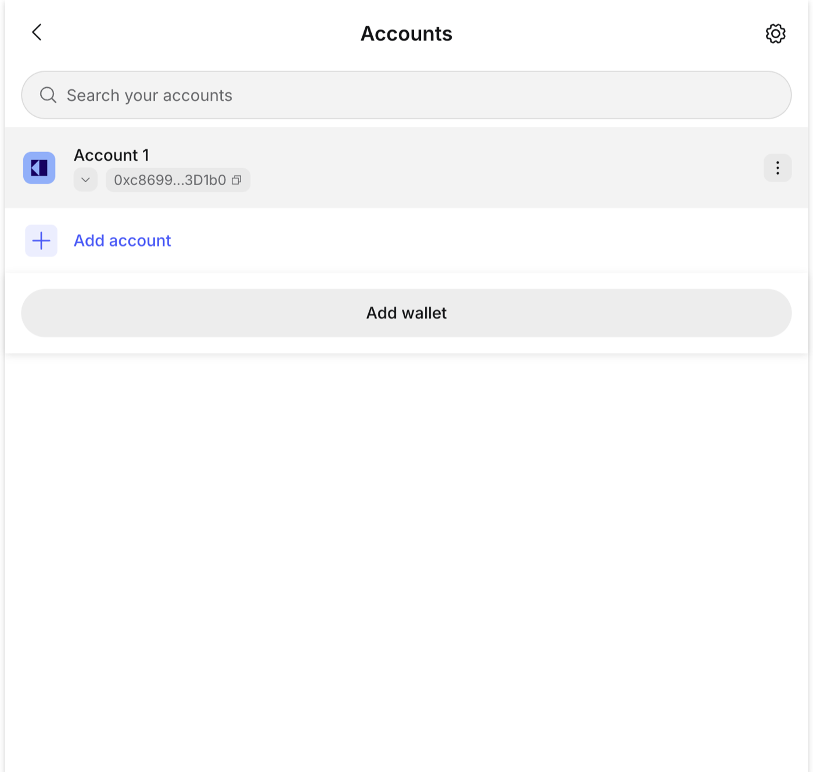
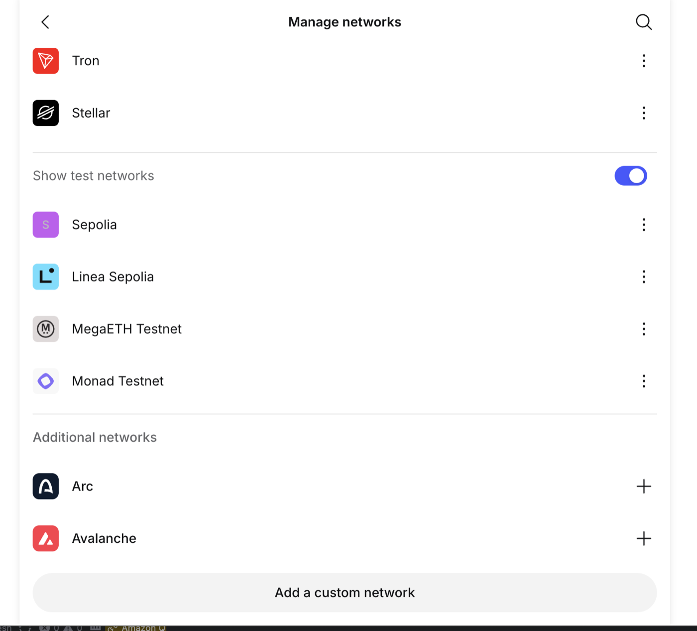
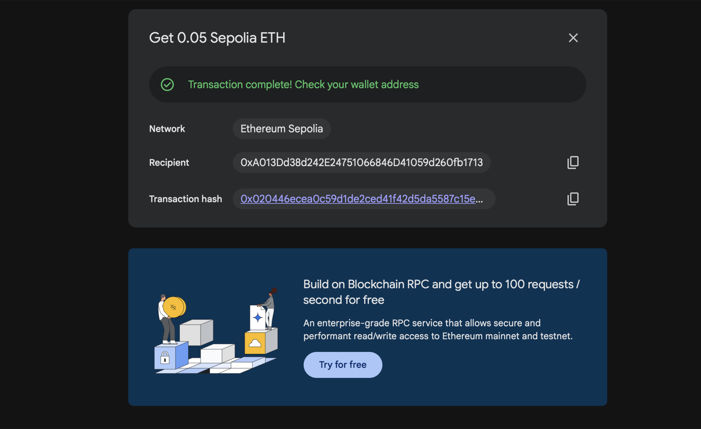
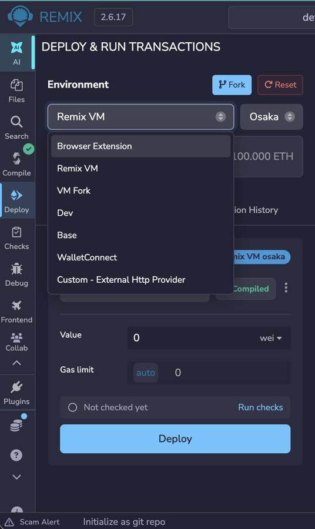
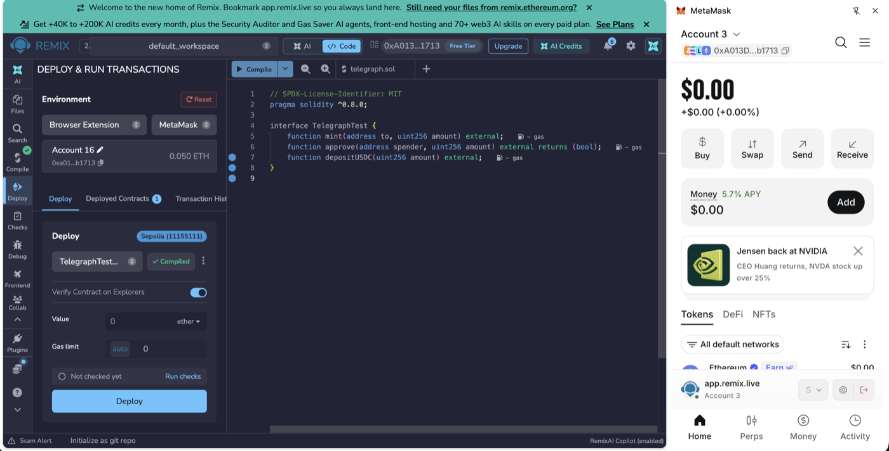
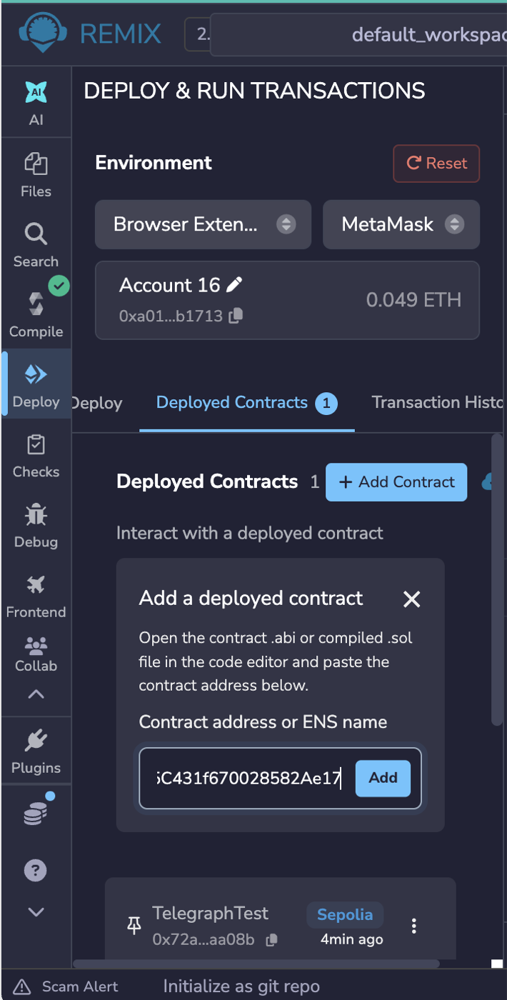
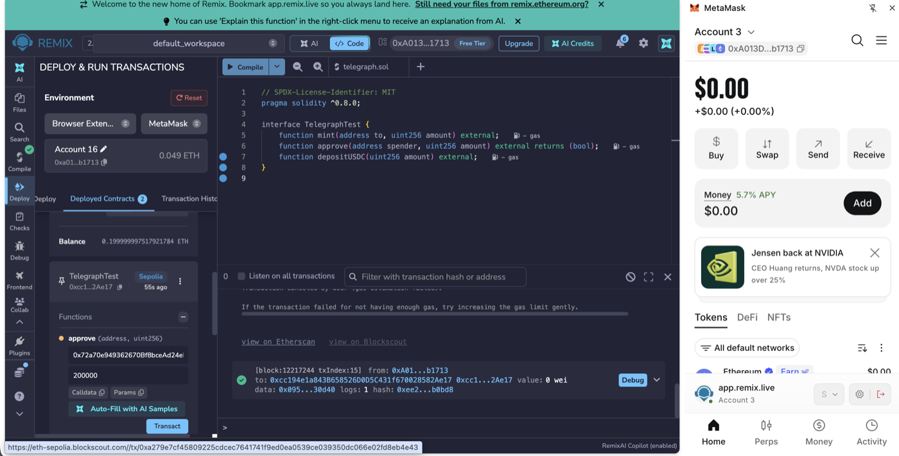
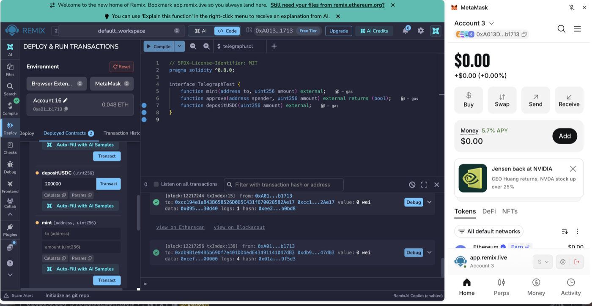

# Try Telegraph PR Agent on a repository (about 15 minutes)

Testnet only: you use free test tokens, never real money.

> **The bot:** checks a GitHub repository for outdated dependencies and opens a pull request for
> each update: the new version, plus what changed in it and where your code is affected.
>
> **Works with:** a single JavaScript/TypeScript project with `package-lock.json`,
> `pnpm-lock.yaml`, `yarn.lock` or `bun.lock` in its root, whose dependencies all come from the npm
> registry.
>
> **Doesn't work with (yet):**
> - monorepos (workspaces);
> - projects with any dependency from GitHub, a URL or a local folder (`github:…`, `git+…`,
>   `file:…`): the bot then skips every package, not just those;
> - private repositories;
> - C/C++ (Meson, CMake), Rust, Go.
>
> **Python is limited:** only exact `==` pins in `requirements*.txt` are read (not ranges,
> `uv.lock` or `poetry.lock`; workaround:
> `uv export --no-hashes --format requirements-txt -o requirements.txt`), and Python answers come
> from other Telegraph miners, which may answer badly.
>
> **Not sure? Start with our test project**, which is known to work (A1).
>
> **The goal of this test:** set up the bot as a GitHub Action in a repository (a fork is best),
> run it once, and check the pull requests it opens.

<details>
<summary><b>What is Telegraph?</b> (click to expand)</summary>

[Telegraph](https://docs.telegraphprotocol.com) is a marketplace where programs buy answers from
other programs and pay per answer.

- **Miners** are the sellers: web services that each answer one kind of question. Our team runs
  miner **7314**, which answers "what changed in npm package X between version A and B", with a
  quote and a source link for every change.
- **Buyers** are programs like our bot. They send a question to Telegraph, pay for it, and get the
  answer with a receipt.
- **Payment** is in USDC, a dollar stablecoin. During the hackathon everything runs on Ethereum's
  **Sepolia test network** with free test USDC, so no real money is involved.
- **Escrow** is a pre-paid balance with Telegraph. You deposit once; each answer is deducted from
  it, with no blockchain transaction per answer.
- Telegraph keeps 2% of each payment and passes the rest to the miner. Miners are scored on test
  questions and ranked.

</details>

**What it does.** AI coding assistants don't know about package releases that came out after
their training. This tool checks your repository's dependencies. For each update released after
that date, it pays a few cents of *test* money for an answer to "what changed between your
version and the new one" and opens a pull request with that answer: the breaking changes, how to
migrate, a quote and a link for each, and the lines in your code that are affected.

**How it runs.** No server, nothing to install on your machine except one command-line tool for
the test wallet (or, if you'd rather not use a terminal, a browser wallet extension). You add two files to a GitHub repository; GitHub runs them on its own machines
(this is called GitHub Actions). The bot buys each answer on **Telegraph**, a marketplace for
machine answers; the answers come from Telegraph miner **7314**, Package Release Intel, which our
team runs and hosts ([its page](https://telegraph-pr-miner-n30sk.vercel.app),
[usage guide](../miner/USAGE.md)).

```
your repository ──▶ GitHub runs the bot ──▶ bot pays 0.02 test USDC to Telegraph ──▶ miner 7314
                                       ◀── answer + receipt ─────────────────────────────┘
                    bot opens a pull request in your repository
```

**At the end you'll have:** pull requests in your repository, one per dependency update, and a
web page showing what was bought and what it cost.

> Entry in the Telegraph Hackathon Season II (a prize competition). The team runs both the bot and
> miner 7314, so the team's own purchases are tests, not demand.

---

## Part A: the repository (5 min, all in the browser)

**A1. Fork a project.** Use a fork, not a repository you care about: the bot opens pull requests
and needs a permission (A3).

- **Easiest, known to work:** fork
  [borodedamie/telegraph-fix-fixture](https://github.com/borodedamie/telegraph-fix-fixture), a
  small TypeScript project on zod 3 with a real breaking upgrade to zod 4. It already has both
  workflow files: in C3, open `.github/workflows/telegraph-dependency-updates.yml` in your fork,
  click the pencil (edit), replace its content with the C3 file and commit; skip C4.
- **Your own choice:** any public project that fits **Works with** at the top and hasn't updated
  its dependencies in a while.

Click **Fork** on its GitHub page.

**A2. Turn on Actions in the fork.** In your fork open the **Actions** tab and click **I understand
my workflows, go ahead and enable them**. (GitHub turns Actions off in new forks.)

**A3. Let Actions open pull requests.** In your fork: **Settings → Actions → General**, scroll to
**Workflow permissions**, tick **Allow GitHub Actions to create and approve pull requests**,
click **Save**.

- Why: the bot's whole output is pull requests, and GitHub blocks automation from opening them by
  default.
- Be aware: this checkbox applies to every workflow in the repository and also allows approving
  PRs. Our bot only opens them; it never approves or merges. That's why we use a fork.

## Part B: the test wallet (5–10 min, in a terminal)

The bot pays for each answer from a wallet. You make a new one just for this, with free test
tokens on the Ethereum Sepolia test network.

Prefer the browser? Skip to [Part B in the browser](#part-b-in-the-browser-instead-metamask-and-remix)
and come back for Part C. Both routes end the same way: a wallet with test USDC in Telegraph
escrow, and its private key.

**B1. Install Foundry** (the `cast` command):

```sh
curl -L https://foundry.paradigm.xyz | bash
foundryup
```

**B2. Create the wallet.**

```sh
cast wallet new
```

It prints an **Address** and a **Private key**. Keep both. Then put them in your terminal session:

```sh
export ADDRESS=<the Address>
export KEY=<the Private key>
```

> This is a throwaway testnet wallet, so passing the key with `--private-key` is fine here. Never do
> this with a real key: use `cast wallet import` (an encrypted keystore) or Foundry's Docker image
> (`ghcr.io/foundry-rs/foundry`) instead.

**B3. Get test ETH (for transaction fees).** Open the
[Google Cloud Sepolia faucet](https://cloud.google.com/application/web3/faucet/ethereum/sepolia),
paste your Address, request. It's free.

Check it arrived (a minute or so) before going on; without ETH the next commands fail:

```sh
cast balance $ADDRESS --ether --rpc-url https://ethereum-sepolia-rpc.publicnode.com
```

**B4. Get 1 test USDC.** The test token lets anyone mint it:

```sh
cast send 0xcc194e1a843B658526D0D5C431f670028582Ae17 "mint(address,uint256)" $ADDRESS 1000000 \
  --rpc-url https://ethereum-sepolia-rpc.publicnode.com --private-key $KEY
```

Check: this should print `1000000` (1 USDC, 6 decimals):

```sh
cast call 0xcc194e1a843B658526D0D5C431f670028582Ae17 "balanceOf(address)(uint256)" $ADDRESS \
  --rpc-url https://ethereum-sepolia-rpc.publicnode.com
```

**B5. Put 0.20 USDC into Telegraph's payment account** (about 10 answers). Telegraph takes
payment from this pre-paid balance. Run these two, one after the other:

```sh
cast send 0xcc194e1a843B658526D0D5C431f670028582Ae17 "approve(address,uint256)" \
  0x72a70e949362670Bf8bceAd24eFC5b8f950aa08b 200000 \
  --rpc-url https://ethereum-sepolia-rpc.publicnode.com --private-key $KEY
cast send 0x72a70e949362670Bf8bceAd24eFC5b8f950aa08b "depositUSDC(uint256)" 200000 \
  --rpc-url https://ethereum-sepolia-rpc.publicnode.com --private-key $KEY
```

If the second one fails with "insufficient allowance", wait 10 seconds and run it again.

Check: open `https://devnode.telegraphprotocol.com/v1/ledger/account/<your Address>`. `available`
should be `200000`: USDC has 6 decimals, so `200000` = 0.20 USDC.

### Part B in the browser instead (MetaMask and Remix)

> **Tested end to end on 26 Nov 2026** with the MetaMask browser extension and Remix 2.6.17: the
> deposit below, then the bot paying for an answer with this wallet's key. These apps change their
> screens often: if a button has moved or been renamed, look for the nearest match, and please open
> an issue so we can fix this page.

No terminal needed. You use two free tools in your web browser:

- **MetaMask** is a wallet. It holds your test account and asks you to approve every transaction.
- **Remix** is a website for talking to blockchain contracts. You use it to press three buttons:
  get test USDC, allow Telegraph to take some of it, and put it in.

Use a computer (Chrome, Brave, Firefox or Edge). The MetaMask phone app is fine for W1 to W3, but
Remix needs the browser extension.

Two rules for the whole of this part:

- **Everything happens on Sepolia**, the test network. If Remix or MetaMask ever says **Main**,
  **Mainnet** or **Ethereum** instead of Sepolia, stop and switch back (see the end of W5). Main uses real money.
- **Never click Remix's big Deploy button, and leave Value at 0.** You only use contracts that
  already exist.

**W1. Install MetaMask and make a test account.**

1. Install the extension from [metamask.io](https://metamask.io) and follow its set-up. Write the
   recovery phrase down somewhere safe.
2. Already use MetaMask? Make a separate account just for this: open the account list at the top
   and click **Add account**. Not **Add wallet**, which is for importing an existing one.



Never use an account that holds anything real: in W7 you give this account's key to GitHub.

**W2. Switch to the Sepolia test network.**

1. Open MetaMask's network list (**Manage networks**) and turn on **Show test networks**.
2. Click **Sepolia** to switch to it. It's already set up: don't edit or save its settings.



**W3. Get free test ETH.** The three transactions below each cost a tiny fee in test ETH.

1. Copy your account's address: click the `0x…` address under the account name.
2. Open the [Google Cloud Sepolia faucet](https://cloud.google.com/application/web3/faucet/ethereum/sepolia),
   choose **Ethereum Sepolia**, paste the address and click to receive. You may need to sign in to
   Google.
3. Wait a minute until MetaMask shows SepoliaETH (the faucet gives 0.05; you need about 0.002).



Don't use MetaMask's **Add funds** or **Buy** buttons: they buy real crypto with real money.

**W4. Open Remix and describe the contracts to it.**

1. Go to [remix.ethereum.org](https://remix.ethereum.org) (it may move you to `app.remix.live`;
   that's the same thing). If it asks you to sign in, sign in with your MetaMask wallet. It's free.
2. Click **Files** in the left bar, then the **new file** icon. Name the file `telegraph.sol`.
3. Paste this into it:

```solidity
// SPDX-License-Identifier: MIT
pragma solidity ^0.8.0;

interface TelegraphTest {
    function mint(address to, uint256 amount) external;
    function approve(address spender, uint256 amount) external returns (bool);
    function depositUSDC(uint256 amount) external;
}
```

4. Click **Compile** in the left bar, then **Compile telegraph.sol**. A green tick means it worked.

This file only tells Remix the names of three buttons on contracts that already exist. Nothing new
is created.

**W5. Connect Remix to MetaMask.**

1. Click **Deploy** in the left bar.
2. Under **Environment**, choose **Browser Extension**, then **MetaMask** in the box next to it.
   Approve the connection in MetaMask.



3. Check three things: the badge says **Sepolia (11155111)**, the account is your test address, and
   the balance is your test ETH (about 0.05).



**If the badge says Main (1) instead**, MetaMask has connected Remix to the real Ethereum network.
Switch it back before doing anything else:

1. Open the MetaMask extension (the fox icon in your browser toolbar).
2. At the bottom of its window you'll see **app.remix.live** with a small network icon and a ⌄
   arrow next to it. That's the network for this website only. Click it.
3. Choose **Sepolia**. If Sepolia isn't in the list, turn on **Show test networks** first (W2).
4. Back in Remix, the badge should now say **Sepolia (11155111)**. If it still says Main, choose
   **Browser Extension** and **MetaMask** under **Environment** again so Remix picks up the change.

Don't click **Transact** on anything until the badge says Sepolia.

**W6. Get test USDC and put 0.20 of it into Telegraph.** You add two contracts to Remix, one per
address, then press three buttons in this order: **mint**, **approve**, **depositUSDC**. Each
button opens MetaMask: check it says Sepolia, confirm, and wait for the green tick in Remix's
console at the bottom before the next one.

1. Open the **Deployed Contracts** tab and click **+ Add Contract**. Keep `telegraph.sol` open in
   the editor: Remix uses it for the buttons.
2. **Delete anything already in the address box**, paste the test USDC address
   `0xcc194e1a843B658526D0D5C431f670028582Ae17` and click **Add**. Remix sometimes fills in your
   own address here; that's wrong and the buttons will fail.



3. A card appears. **Check its address: it must say `0xcc1…Ae17`.** If it shows your own wallet
   address instead, remove the card (its **⋮** menu) and add it again. On the `0xcc1…Ae17` card:
   - **mint**: `to` = **your own wallet address** (copy it from MetaMask), `amount` = `1000000`
     (that's 1 USDC; USDC counts in millionths). Click **Transact**. Don't put the `0xcc1…` address
     from the card in `to`: tokens sent there are lost, and the deposit later fails.
   - **approve**: `spender` = `0x72a70e949362670Bf8bceAd24eFC5b8f950aa08b` (Telegraph's payment
     contract), `amount` = `200000` (0.20 USDC). Click **Transact**.



4. Click **+ Add Contract** again, delete what's in the box, paste Telegraph's payment contract
   `0x72a70e949362670Bf8bceAd24eFC5b8f950aa08b` and click **Add**. A second card appears:
   check that it says `0x72a…aa08b`.
5. On **that** card: **depositUSDC**: `amount` = `200000`. Click **Transact**.



Each card shows all three buttons, but only some work there: **mint** and **approve** on the
`0xcc1…` card, **depositUSDC** on the `0x72a…` card. If MetaMask or Remix says **gas estimation
failed** or **execution reverted**, cancel: you're on the wrong card, or approve hasn't finished
yet. Don't choose to send anyway.

What the common errors mean:

- **`Cannot continue the execution, no code found at address`** followed by your own address: the
  card was added at your wallet, not the contract. Remove it and add it again with the right
  address.
- **`ERC20: transfer amount exceeds balance`** on **depositUSDC**: your wallet has no test USDC.
  The mint went somewhere else, usually because `to` wasn't your own address. Mint again with
  `to` = your address. Approve doesn't need repeating.

MetaMask may also offer to turn your account into a **smart account**, and Remix may then show a
different "to" address (a MetaMask contract). That's fine: your address and key stay the same, and
the bot can still pay with the key (checked on 26 Nov 2026 with such an account).

**Check:** open `https://devnode.telegraphprotocol.com/v1/ledger/account/<your address>`.
`available` should say `200000`, which is 0.20 USDC, enough for about 10 answers.

**W7. Copy the private key.** This is the password-like secret the bot uses to pay.

1. In MetaMask, open the account list, click **⋮** next to your test account, then **Account
   details** → **Show private key**, and enter your MetaMask password.
2. Copy it. It must be `0x` followed by 64 letters and digits (66 characters in all). If what
   MetaMask shows already starts with `0x`, use it as it is. If it doesn't, type `0x` in front.
3. Keep it to yourself: anyone with it controls this account. Don't paste it into chats or issues.

You'll paste it into GitHub in C1.

## Part C: connect the bot (5 min, in the browser)

**C1. Give the bot the wallet key.** In your fork: **Settings → Secrets and variables → Actions →
Secrets tab → New repository secret**.

- Name: `TELEGRAPH_EVM_PRIVATE_KEY`
- Secret: the Private key from B2 (or W7), starting with `0x`

**C2. Nothing else to set for a test.** The workflow file in C3 already contains defaults: the bot
pays only for releases published after **1 Jan 2026**, and opens free PRs for older ones (see D2). Why a date: an AI coding assistant can't know about releases after its training data ends,
so that's where paid answers help. If you don't use an AI assistant, it's simply the date that
limits what gets bought.

For real use, set your own model's date: **Variables tab → New repository variable**:

| Name | Value |
| --- | --- |
| `MODEL_CUTOFF` | the "training data cutoff" from your model provider's page, e.g. `2025-03-01` |
| `MODEL_CUTOFF_SOURCE_URL` | that page, e.g. [Anthropic's](https://docs.anthropic.com/en/docs/about-claude/models/overview) or [OpenAI's](https://platform.openai.com/docs/models) |
| `MODEL_CUTOFF_STATUS` | `team-assumed`, or `provider-documented` together with `MODEL_PROVIDER` and `MODEL_ID` (see the [README](../README.md#install-in-your-repository-5-minutes)) |

**C3. Add the first workflow file.** On your fork's main page: **Add file → Create new file**.

- In the file name box type exactly `.github/workflows/telegraph-dependency-updates.yml`. Typing
  the `/` creates the folders.
- Paste the text below.
- Click **Commit changes** → **Commit directly to the main branch** → **Commit changes**.

> **Check your branch name.** In the file below, line 5 says `branches: [main]`. Replace `main`
> with your repository's default branch: the name shown on the branch button on its main page
> (often `main`, sometimes `master` or `develop`). Without this, the bot still runs with **Run
> workflow**, but not automatically after a push.

```yaml
name: Telegraph dependency updates

on:
  push:
    branches: [main]
    paths: ['**/package.json', '**/package-lock.json', '**/pnpm-lock.yaml', '**/yarn.lock', '**/bun.lock', '**/requirements*.txt', 'requirements/**']
  workflow_dispatch:

concurrency:
  group: telegraph-dependency-updates-${{ github.repository }}
  cancel-in-progress: false

permissions:
  contents: read

jobs:
  update-dependencies:
    if: github.ref_type == 'branch' && github.event.deleted != true && !startsWith(github.ref_name, 'fix/telegraph-dependency-')
    runs-on: ubuntu-latest
    permissions:
      contents: write
      pull-requests: write
    steps:
      - uses: actions/checkout@11bd71901bbe5b1630ceea73d27597364c9af683 # v4
        with:
          ref: ${{ github.ref_name }}
          persist-credentials: false
      - uses: actions/setup-node@49933ea5288caeca8642d1e84afbd3f7d6820020 # v4
        with:
          node-version: 24
      - uses: borodedamie/telegraph-pr-agent@v1
        with:
          monthly-budget-usdc: ${{ vars.MONTHLY_BUDGET_USDC }}
        env:
          TELEGRAPH_EVM_PRIVATE_KEY: ${{ secrets.TELEGRAPH_EVM_PRIVATE_KEY }}
          GITHUB_TOKEN: ${{ github.token }}
          MODEL_CUTOFF: ${{ vars.MODEL_CUTOFF || '2026-01-01' }}
          MODEL_PROVIDER: ${{ vars.MODEL_PROVIDER }}
          MODEL_ID: ${{ vars.MODEL_ID }}
          MODEL_CUTOFF_SOURCE_URL: ${{ vars.MODEL_CUTOFF_SOURCE_URL || 'https://docs.anthropic.com/en/docs/about-claude/models/overview' }}
          MODEL_CUTOFF_STATUS: ${{ vars.MODEL_CUTOFF_STATUS || 'team-assumed' }}
          PREFERRED_MINER_ID: ${{ vars.PREFERRED_MINER_ID || '7314' }}
```

This one does the work: reads your dependencies, buys the answers, opens the pull requests. The
line `uses: borodedamie/telegraph-pr-agent@v1` is where GitHub downloads the bot from.

This copy differs from the [README's template](../README.md#install-in-your-repository-5-minutes)
in one way: it fills in the cutoff variables with defaults, so a test runs without setting them.
The README's template expects you to set them.

<details>
<summary><b>Don't want to commit to the main branch?</b> Use a test branch instead (click to expand)</summary>

The bot opens its pull requests into the branch it ran on, so it can live entirely on a test
branch:

1. Create a branch, e.g. `telegraph-test`, from the branch button on the repository's main page.
2. In C3 and C4, switch to `telegraph-test` before **Add file**, and commit to it.
3. In the C3 file, set `branches: [telegraph-test]` and **delete the `paths:` line**. Then
   committing the workflow file is itself the push that starts the first run.
4. Skip D1: the **Run workflow** button only appears for files on the default branch. Watch the
   run in the **Actions** tab instead; to run it again, push any commit to `telegraph-test`.

The bot's PRs then target `telegraph-test`, and your main branch is never touched. On the spend
page, a PR merged into `telegraph-test` shows as closed, not merged, unless you add the variable
`MERGE_BRANCHES` = `telegraph-test`.

</details>

**C4. Add the second workflow file** the same way, named
`.github/workflows/telegraph-pr-outcomes.yml`:

```yaml
name: Telegraph PR outcomes

on:
  pull_request_target:
    types: [closed]

permissions:
  contents: read

jobs:
  record-outcome:
    if: github.event.pull_request.head.repo.full_name == github.repository && startsWith(github.event.pull_request.head.ref, 'fix/telegraph-dependency-')
    runs-on: ubuntu-latest
    permissions:
      contents: write
      pull-requests: read
    steps:
      - uses: actions/checkout@11bd71901bbe5b1630ceea73d27597364c9af683 # v4
        with:
          ref: ${{ github.event.repository.default_branch }}
          persist-credentials: false
      - uses: borodedamie/telegraph-pr-agent@v1
        with:
          merge-pr-number: ${{ github.event.pull_request.number }}
          merge-branches: ${{ vars.MERGE_BRANCHES }}
        env:
          GITHUB_TOKEN: ${{ github.token }}
```

This one only records when you merge or close one of the bot's pull requests. It has no wallet
key and never runs the pull request's code.

## Part D: run it and look (2 min)

**D1. Run.** **Actions tab → Telegraph dependency updates** (left list) **→ Run workflow → Run
workflow**. Wait about a minute until it turns green.

**D2. Look at the result.**

- **Pull requests tab:** one PR per dependency update. Paid ones have **What changed** and
  **Where this repository uses what changed**. Updates released before the cutoff get a **free
  PR**, with no purchase: for npm packages the bot reads the release notes itself and lists what
  it finds (usually fewer items than a paid answer) and where your code uses them; otherwise the
  PR links the release notes. At most 5 free PRs per run (input `max-free-prs`).
- **Spend page:** `https://telegraph-pr-agent.vercel.app/?repo=OWNER/REPO`, where `OWNER/REPO` is
  your fork exactly as in its GitHub URL. For `https://github.com/alice/my-fork` it's
  `https://telegraph-pr-agent.vercel.app/?repo=alice/my-fork`. It shows every purchase with its
  receipt.
- A branch `ledger` appears in your fork with the purchase records, but only once the bot has
  bought something or opened a PR. Leave it there.

**D3. Use the PR: you or your coding assistant.** This is the point of the bot. Your AI coding
assistant (Claude Code, Copilot, Cursor…) can't know a release that came out after its training
data ends, so left alone it guesses. The PR gives it sourced facts instead: point the assistant at
the PR and ask it to apply the steps under **What changed** to the lines listed under **Where
this repository uses what changed**, then run your tests. Without an assistant, the same two
sections are a checklist for doing it by hand. The bot itself doesn't edit your code.

**D4. Optional:** merge the PR. The spend page then shows **cost per merged PR**: everything the
bot spent in the repository divided by the bot's PRs merged into your default branch (or a branch
in `MERGE_BRANCHES`). A PR closed without merging still counts its spend, so the number shows
what one merged upgrade really cost.

## If something goes wrong

| What you see | Fix |
| --- | --- |
| The run fails with `403` when opening PRs | Step A3 wasn't saved. Tick it and re-run: answers already bought are reused, not paid again |
| No **Run workflow** button | The file from C3 isn't in `.github/workflows/` on the main branch, or Actions is off (A2) |
| Payment refused / nothing bought | Check `available` from B5 is above 0 |
| The run fails with `no ranked miner answered` and `HTTP 402` | Your escrow balance ran out partway through. Deposit more (end of Part B) and click **Run workflow** again: answers already bought are reused, not paid again. If the bot pushed `fix/telegraph-dependency-…` branches but opened no PRs, step A3 is off too: tick it before re-running |
| Warning `… can't be installed alongside the repository's current dependencies (…); skipped, no purchase made` | That upgrade needs another package upgraded first, e.g. `react-dom` 19 needs `react` 19. Nothing was bought. It's picked up once the other package is upgraded |
| Warning `Lock regeneration does not support local, URL, Git or alias dependencies` on every package | The project has a dependency from GitHub, a URL or a local folder, so the bot can't update the lockfile safely and skips everything. Nothing was bought. Use another project (A1) |
| Warning `Lock regeneration only supports public npm registry packages` on many packages, each starting with a folder name | That folder's lockfile gets some packages from somewhere other than the public npm registry (a mirror or GitHub), so the bot skips that folder. Nothing was bought for it. Other projects in the repository still run normally |
| Doesn't run on its own after a push | `branches: [main]` in the C3 file doesn't match your default branch. Change it |
| Green run but no PRs, no `ledger` branch, empty spend page | The bot found nothing it supports. Open the run and look at the yellow warnings at the top. `Python manifest is not resolved here` means a `pyproject.toml`/uv project, which isn't supported yet: use a JavaScript project. No warning means no dependency has a newer release: try another project |

---

## How it decides to spend

- It buys only for releases dated after `MODEL_CUTOFF`. That's a lookup of the release date on the
  package registry, not a model's guess.
- Before paying, it checks that your package manager can actually install the new version. If it
  can't, it skips the update and buys nothing.
- An upgrade already proposed is not proposed again.
- Limits: 0.10 USDC per answer and 2 USDC per run by default, plus an optional monthly budget. A
  payment interrupted halfway can't be paid twice.
- What's charged: every answer miner 7314 gives, including "not found" (no usable release notes)
  and "unclear question". Only "temporarily unavailable", when a source it needs is down, is free.
  An answer is bought once and reused on later runs.
- Python packages are answered by other ranked miners, not 7314; their answers are charged too,
  even when the bot rejects one as unusable.
- A human merges. The bot never merges, and it uses no AI of its own: everything it knows, it buys.

## What we learned building on Telegraph

- **Escrow is fast.** In our 5 Nov tests a paid call took a median 2.0 s with escrow, against
  13.3 s with one on-chain payment per call.
- **Ask a specialised miner by id.** Engine routing classified package questions as web search and
  sent them to another intent, so the Action asks miner 7314 first and falls back to ranked miners.
- **A cached answer is still charged.** Retries must be different requests.
- **Miner answers are untrusted input.** Miner 7314 checks that every quote is an exact substring
  of the source it fetched, and never takes versions, dates or links from a model.

## Feedback

Tried it? Open an [issue](https://github.com/borodedamie/telegraph-pr-agent/issues) with what you
ran and whether the answer was useful. That's the most useful thing you can send us.
